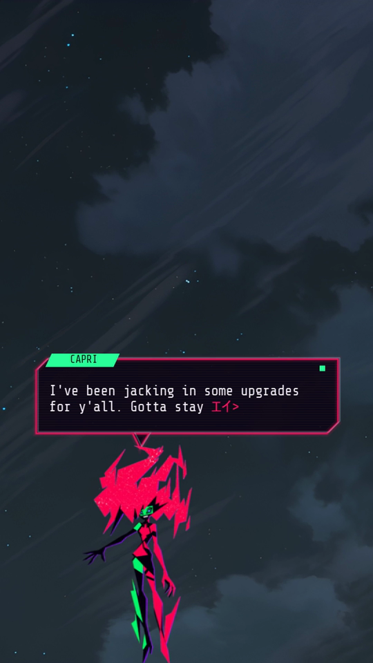
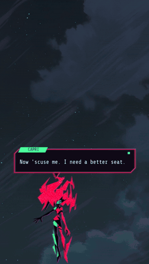
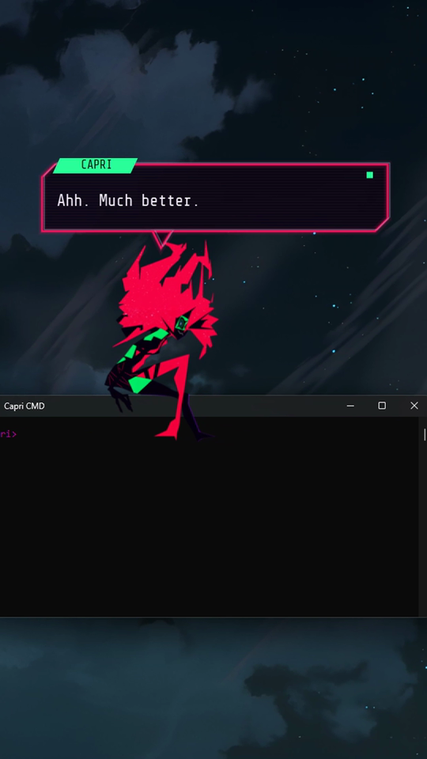
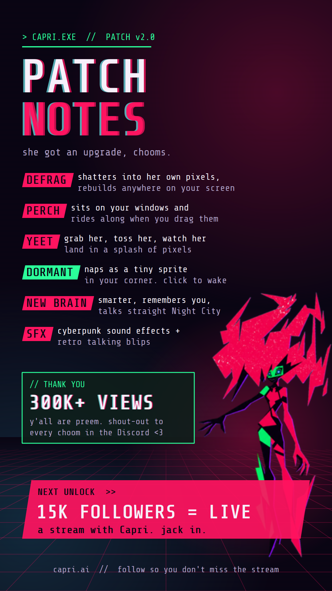

<p align="center">
  
  
  
</p>

<h1 align="center">Capri</h1>

<p align="center">
  <b>Capri from <i>Cyberpunk: Edgerunners 2</i>, living on your Windows desktop.</b><br>
  She sits on your windows, talks back, remembers you, hears you, vibes to your music and roasts your taste.<br>
  100% local: no API keys, no cloud, no subscription.
</p>

<p align="center">
  
  
  
  
  
  
  
</p>

<p align="center">
  <a href="#quick-start">Quick start</a> ·
  <a href="#what-she-does">What she does</a> ·
  <a href="#bring-your-own-model">Bring your own model</a> ·
  <a href="#how-it-works">How it works</a> ·
  <a href="#contributing">Contributing</a>
</p>

---

## Quick start

**You need:** Windows 10/11 (64-bit), [Python 3.10-3.12](https://www.python.org/downloads/), and a GPU with
4-8 GB of VRAM (NVIDIA, AMD or Intel).

```bat
git clone https://github.com/Capri-cmd/capri-ai.git
cd capri-ai
start.bat
```

The first run makes its own Python environment (`.venv`, no torch, no CUDA toolkit) and opens the **setup window**:

| Pick | Options | Size |
| --- | --- | --- |
| **Brain** (one or more) | Mistral-Nemo 12B (smartest) · Conversational 7B (fast) · CapriAI2, Qwen3.5 4B (trained to be Capri) | 3.3 - 6.3 GB each |
| **Ears** | whisper.cpp tiny · base · small · medium, or none (type only) | 74 MB - 1.4 GB |
| **Engine** | llama.cpp on Vulkan (any GPU) or CUDA (NVIDIA) | 35 MB / 640 MB |

It shows the total next to your free space, downloads (pausable, resumes if your connection drops) into `models\`
and `engines\` inside the folder, then starts her. Nothing is installed system-wide. `start.bat --setup` opens it
again later; so does right-click > **Brain** > *Download more*.

## What she does

- **Lives on your desktop.** Stands on the taskbar, sits on your window title bars and icons, and rides along when
  you drag a window. Close it and she falls.
- **Defrags.** Every so often she breaks into her own pixels, they stream across the screen, and she rebuilds
  somewhere else. Grab her and throw her; she lands in a splash of pixels.
- **Talks back, like a call.** Hold **Ctrl+1** and talk, or click her and type. Her chat box shows her live face (it
  blinks and talks), the call timer and your line, and her reply decodes in as she writes it.
- **Follows the conversation.** The last 12 exchanges ride along with every reply, and a reminder keeps her on what
  you just said.
- **Remembers you.** She picks up facts from normal chat (your cat's name, your games, what you hate) and uses them
  later. "remember that I main Jett" works too.
- **Sees what you're doing.** "what am I doing?" makes her read the window you're in (Windows OCR; logins, banking
  and private windows are skipped, nothing is saved). She reacts now and then, and checks in when you go quiet.
- **Music.** "play Nightcall", "something like Ado on Spotify", "skip", "pause". Her hair glitches to the beat of
  whatever's playing.
- **Naps.** Tray click or the zZ button: she shrinks into a sleeping screen-face in the corner until you wake her.
- **Never repeats herself.** Her recent openers get pushed down in the model, and a reply that repeats an old line
  is thrown away and rewritten before you see it.

<p align="center">
  
  
</p>

| Do this | She does |
| --- | --- |
| Hold **Ctrl+1** and talk | Hears you and answers (right-click > **Ears**: rebind, always-listening, mic, whisper model) |
| Click her | Opens her chat box |
| Drag her, let go mid-swing | Throws her |
| Double-click | Defrags somewhere new |
| Right-click | Jack in, Defrag, Nap, Ping her, Roam, Vibe, Watch my screen, Chatter, **Brain**, Delta (quit) |

Set your name in `config.yaml` (`user_name`) so she knows what to call you.

## Bring your own model

Drop any `.gguf` into `models\llm`, right-click her > **Brain**, pick it. It swaps live, no restart. Anything the
bundled llama.cpp release runs works (Qwen3.5, Llama, Mistral, Gemma...); the chat template comes from the GGUF and
thinking is switched off.

Training a Capri model? `python tools/export_harness.py` writes `capri_harness.py`: her exact prompt (character
sheet, examples, reminder, notes, sampling, reply clean-up) as one standalone file you can chat through or build
training data from.

## How it works

```
capri_dev.py         entry point: setup window on the first run, then her
capri/
  desk/       capri.py (states, physics, defrag) · fx.py (effects) · bubble.py (call-style chat box)
              ledges.py (windows / icons / taskbar to sit on) · sfx.py (synthesized sounds) · app.py (wiring)
  brain/      persona.py (her character) · agent.py (reply loop, memory, anti-repeat) · intents.py · llm.py
  abilities/  memory · launcher (apps + YouTube) · vision (window + OCR) · music (beat detection) · spotify
  voice/      stt.py (mic + whisper.cpp) · hotkey.py (hold-to-talk)
  portable.py · setup.py   what setup downloads and where it goes
```

- **Brain:** llama.cpp's `llama-server`, started and stopped with her. The prompt never changes at the top, so only
  new words get read; replies stream sentence by sentence.
- **Ears:** whisper.cpp's `whisper-server` on the CPU, so the GPU stays free for her brain.
- **Prompt:** no system message. Her character sheet is the first user turn, then her acknowledgement, a few
  example chats, the conversation, and your message with notes and a short reminder.
- **Sounds:** every effect and her talking blips are synthesized in code; no sample files.

`build_dev.bat` packs it all into a portable `Capri.exe` (PyInstaller); `tools/make_dev_test.py` makes a
source-only test zip.

## Contributing

**We want contributors!** Artists, coders, testers: see [CONTRIBUTING.md](CONTRIBUTING.md). Good first things:

- A close-up portrait of her for the chat box (normal, blink, talking).
- Original sprites under a permissive license, so Capri can drop the non-commercial restriction.
- A local voice for her.
- macOS / Linux support.

Tests (no GPU needed): `.venv\Scripts\python -m pytest tests`

## Credits & license

- Code: [MIT](LICENSE).
- Sprites: [lachydotmcg/capri-desktop](https://github.com/lachydotmcg/capri-desktop), PolyForm Noncommercial
  (`assets/desk/LICENSE.md`). Because of them, Capri is **non-commercial** for now.
- Engines: [llama.cpp](https://github.com/ggml-org/llama.cpp) and [whisper.cpp](https://github.com/ggml-org/whisper.cpp) (MIT), downloaded by setup.
- Font: Share Tech Mono, SIL Open Font License.
- Capri and Cyberpunk: Edgerunners belong to CD PROJEKT RED / Studio Trigger. Unofficial fan project, not affiliated
  with or endorsed by them. If they ask, it comes down.
